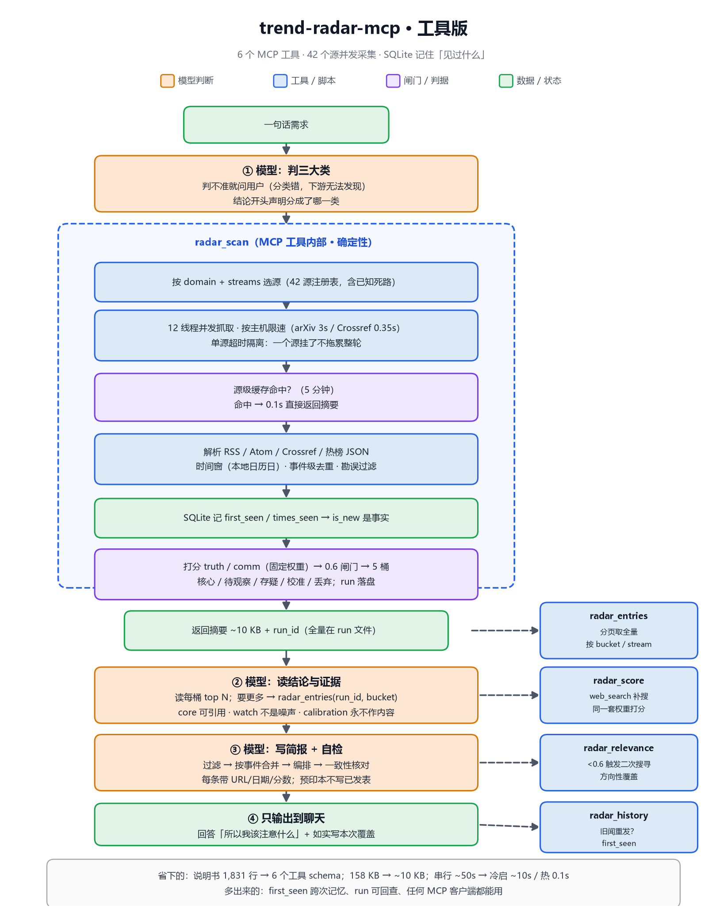

# trend-radar-mcp

把 [trend-radar](https://github.com/ngwddd/trend-radar) 那个 skill 的**确定性部分**拆出来，做成一个有状态、可并发、按需读取的 **MCP 工具**。

原版 skill 保留不动，作为「判断协议 + 采集引擎」的历史版本；这个仓库是分支重写版。

> 一句话区别：原版让模型**照着 1,800 行说明书**跑八个阶段；这一版把「取数、打分、分桶、记住见过什么」交给工具，模型只负责**判断与写作**。

---

## 为什么要拆

| | 原版 skill | 本仓库 |
|---|---|---|
| 形态 | `SKILL.md` + 4 份 references + 3,900 行 CLI 脚本 | 一个 stdio MCP server，6 个工具 |
| 采集 | 源级**串行**，AI 域一轮约 50 s | 源级**并发** + 按主机限速，约 10 s |
| 重复扫描 | 每次都重抓、重读 158 KB compact JSON | 源级缓存 + HTTP 缓存，**0.1 s** |
| 「新」的判断 | 模型猜（无历史） | SQLite `first_seen`，是事实 |
| 数据进上下文 | 320 KB 全量 / 158 KB 精简 | 摘要 ~10 KB，全量走 `radar_entries` 按需取 |
| 判据 | 文档 + 脚本两处维护 | 权重/闸门只有一份 Python 实现 |
| 客户端 | 只服务本 harness | 任何 MCP 客户端（Claude Desktop / Cursor / DSH） |

判据与权重不是新发明的：它们是原版在真实跑批里一条条踩出来的（撤稿拦截、单源硬证据通道、热榜 0.45 封顶、front-matter 识别、身份去重……），这里按模块重排，行为保持一致。

---


## v0.2（2026-10-19）· 效率与纯度

- **判不了类别 → `broad`**：整张注册表 42 源全开，不再逼模型在三类里猜一个。
  `domain` 可省略；返回里 `scope="broad"`。
- **digest 优先**：`radar_scan` 只回 id / 标题 / truth·comm / 来源 / 日期（~5 KB），
  **不含摘要正文**。要写哪几条，用 `radar_entries(ids=[...], fields=["summary"])`
  只取那几条（~3 KB）。
- **自适应跳源**：连续 3 次返回 0 条的源，12 小时内跳过；它一恢复就自动回到列表。
- **硬限制写进 schema**：ids ≤ 20、entries ≤ 50、score ≤ 20 条、keywords ≤ 8、
  摘要默认 300 字、`radar_scan` 响应 ≤ 6.5 KB。
- **修 bug**：`social + authority` 没有权威源时会整轮空跑 → 现在回退到该域全部流，
  并在返回里标 `stream_fallback=true`；不再把「空跑」伪装成「今天没有内容」。
- 实测：broad 冷启 **10.7 s** / 热 **0.3 s**；scan 响应 **5.2 KB**
  （v0.1 为 11 KB，原版 compact JSON 为 158 KB）。

## 架构



```
radar_scan(domain, days, streams)
        │
        ├─ 并发抓 42 个源（ThreadPool，按 host 限速：arXiv 3s / Crossref 0.35s）
        │   └─ 源级缓存 5 min → 重复扫描 <0.5s
        │
        ├─ 归一化：RSS / Atom / Crossref / 热榜 JSON
        ├─ 时间窗（本地日历日）+ 重大事件宽窗
        ├─ 事件级去重（标题 token + 相似度，不是字面匹配）
        ├─ 确定性打分：truth = 0.4·源权重 + 0.6·证据层级；comm = 独立来源数曲线
        ├─ 闸门 0.6 → 核心区 / 待观察区 / 存疑区 / 校准信号 / 丢弃
        ├─ SQLite：first_seen / times_seen（跨次记忆）
        └─ 返回 run_id + 每桶 top N + 统计；全量落在 run 文件里
```

状态与缓存都在 `~/.trend-radar/`（可用 `TREND_RADAR_HOME` 覆盖）：

```
~/.trend-radar/
├── state.db          # items(first_seen) + runs
├── runs/<run_id>.json# 一次扫描的全部条目与统计
└── cache/            # HTTP 响应 + 源级解析结果
```

---

## 工具

| 工具 | 作用 |
|---|---|
| `radar_scan` | 采集 + 打分 + 分桶。返回摘要与 `run_id`，**不返回全量** |
| `radar_entries` | 按 bucket / stream 分页取条目（读全量的唯一入口） |
| `radar_sources` | 42 个源的注册表、三路分类、已知死路 |
| `radar_score` | 给 web_search 补来的条目按同一套权重打分 |
| `radar_relevance` | 阶段 5 关联度（方向性覆盖，<0.6 触发二次搜寻） |
| `radar_history` | 这个事件第一次是什么时候见到的、被见过几次 |

资源：`radar://registry`、`radar://runs`、`radar://runs/{run_id}`、`radar://runs/{run_id}/entries`。

### 分桶语义（写简报前必须看）

| bucket | 含义 | 怎么用 |
|---|---|---|
| `core` | 双项达标，或单源硬证据（`peer-reviewed` 但还没人转） | 可作结论主体；单源的必须标 `single_source_hard_evidence` |
| `watch` | 可信但还没传开 | **不是噪声**，往往是刚出来的论文 |
| `suspect` | 传得广但不可信 | 必须标出来，不许当事实 |
| `calibration` | 热榜 | 只校准传播度/发现遗漏，**永不作内容源** |
| `discarded` | 双项未达标 | 可查，不作依据 |

---

## 安装

无第三方依赖，Python ≥ 3.10。

```bash
git clone https://github.com/ngwddd/trend-radar-mcp.git
cd trend-radar-mcp
python -m unittest discover -s tests      # 20 tests, no network
```

### 接到 DeepSeek Harness

在 profile 的 `cordis.patch.yml` 里追加（和现有的 MCP 服务同一写法）：

```yaml
- insert:
    - id: trend-radar-mcp
      name: '@deepseek-ai/dsh-mcp-client'
      config:
        serverName: trend-radar
        transport: stdio
        command: 'python'
        args:
          - '-m'
          - 'trend_radar_mcp'
        env:
          PYTHONIOENCODING: utf-8
          PYTHONUNBUFFERED: '1'
          TREND_RADAR_HOME: 'C:\Users\ggg\.trend-radar'
        toolCallTimeoutMs: 180000
        failOnStartupError: false
```

`radar_scan` 首轮约 10 秒（冷缓存），失败源会逐条报出来，不会静默。

### 接到 Claude Desktop / 其他 MCP 客户端

```json
{
  "mcpServers": {
    "trend-radar": {
      "command": "python",
      "args": ["-m", "trend_radar_mcp"],
      "env": { "PYTHONIOENCODING": "utf-8" }
    }
  }
}
```

---

## 用法（模型侧契约）

1. **先判三大类**（`social` / `science` / `ai`）。判不准就问用户——分类错了，下游没有任何环节能发现。
2. `radar_scan` 的 `truth_score` / `comm_score` 是引擎算的固定分，**不要自己估**，也不要把两个分合成一个。
3. 「新」看 `is_new` / `first_seen`，不要凭印象。
4. `relevance.needs_second_pass=true` 时不许直接下结论：换角度/关键词重查，再复核权重。
5. 写简报：每条必须有 URL 与日期；预印本不许写成已发表；厂商自述不算独立验证；
   **「本次覆盖」必须如实写失败/降级的源**。
6. 补充检索来的条目先过 `radar_score`，再与主池同权比较。

这六条同时写在 MCP `initialize` 的 `instructions` 里，客户端会自动拿到。

---

## 与 v1 的行为差异

只列**有意**的差异：

- **并发采集**：源级线程池；arXiv / Crossref 仍按主机限速，不改礼貌间隔。
- **源级缓存**：默认 5 分钟；`force_refresh=true` 绕过。
- **首次见到**：`first_seen` 写入 SQLite；`is_new` = 首次见到发生在窗口内。
- **响应体积**：默认每桶 top 6，单次 ~10 KB；全量在 run 文件里。
- **重大事件宽窗**：逻辑保留，但 `major_days` 从默认 0 起算，进来的条目仍标 `in_window=false`。

判据本身没有放松：0.6 闸门、单源硬证据通道、撤稿短路、热榜封顶、front-matter 识别、身份去重全部保留。

---

## 测试

```bash
python -m unittest discover -s tests -v
python tests/smoke_stdio.py      # 真启一个 stdio server，跑一遍握手/工具/资源
```

`tests/test_scan.py` 用 fixture 替掉网络层，验证分桶、`is_new`、`first_seen` 稳定性；
`tests/test_core.py` 覆盖权重、身份、front-matter、去重、关联度。

---

## 路线

- [ ] 把采集适配器再拆一层（`sources/` 每个 kind 一个文件），便于加源
- [ ] `radar_scan` 支持增量：只取 `first_seen` 之后的新条目
- [ ] 事件时间线（同一 `event_id` 的多次出现合并成一条演进）
- [ ] 在真实客户端里补一份评测（同一批输入，对比 v1 的产出质量）

## License

MIT · 与原版 skill 同作者、同许可。判据与权重的出处见源码注释。
