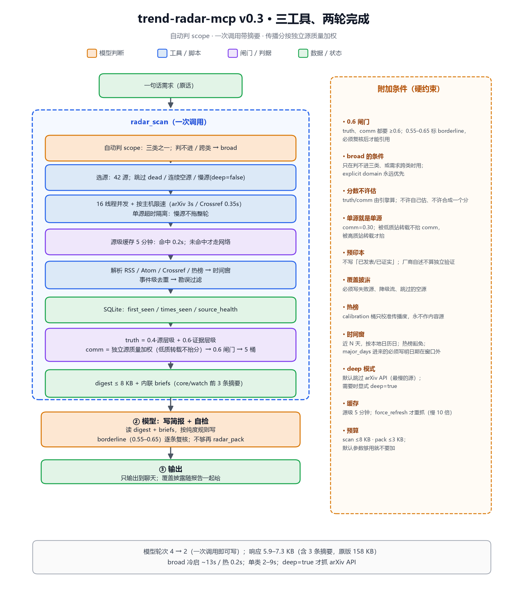

# trend-radar-mcp

把 [trend-radar](https://github.com/ngwddd/trend-radar) 那个 skill 的**确定性部分**拆出来，做成一个有状态、可并发、按需读取的 **MCP 工具**。

原版 skill 保留不动，作为「判断协议 + 采集引擎」的历史版本；这个仓库是分支重写版。

> 一句话：原版让模型**照着 1,800 行说明书跑八个阶段**；这一版把取数、打分、分桶、记忆交给工具，
> 模型只负责判断与写作——**两次调用完成一份简报**。

---

## v0.3（2026-10-19）· 两轮完成

| 改动 | 之前 | 现在 |
|---|---|---|
| 模型轮次（典型） | 判类 → scan → entries → 写（4 轮） | **scan → 写（2 轮）** |
| 工具数 | 6 | **3**（scan / pack / check） |
| 判 scope | 模型先判，判不了才 broad | **工具内自动判**；判不进/跨类 → broad |
| 摘要 | 单独再调一次 entries | **scan 内联 core/watch 前 3 条**（briefs） |
| 传播分 | 按独立源**数量**阶梯 | **按独立源质量加权**（低质转载不抬分） |
| 真值分 | corroboration 同时加 truth 和 comm | **只加 comm**（去掉双重计数） |
| 边界样本 | 0.59 / 0.61 处置相反 | **borderline 带**（0.55–0.65）标出来 |
| arXiv API | 每轮都抓（18 s 量级） | **默认跳过**，`deep=true` 才抓 |

实测：单类冷启 5–9 s（墙钟 = 最慢的源）、broad 冷启 ~13 s、缓存命中 **0.07 s**；扫描响应 5.9–7.3 KB（含 3 条摘要）。
**没有后台任务**：缓存只在请求路径上读写，超过 5 分钟就重新抓；不做定时刷新、不做启动预热。

完整设计说明：[docs/design-v0.3.md](docs/design-v0.3.md) · 上一版：[docs/design-v0.2.md](docs/design-v0.2.md)

---

## 架构



```
radar_scan(query)
        │
        ├─ 自动判 scope（三类 / broad）· 选源（跳过 dead / 空源 / 慢源）
        ├─ 16 线程并发 + 按主机限速（arXiv 3s / Crossref 0.35s）
        ├─ 源级缓存 5 分钟 → 命中 0.07s（无后台刷新）
        ├─ 归一化 → 时间窗 → 事件级去重 → 勘误过滤
        ├─ SQLite：first_seen / times_seen / source_health
        ├─ truth = 0.4·源层级 + 0.6·证据层级
        │  comm  = 独立源质量加权 → 0.6 闸门 → 5 桶（含 borderline 标记）
        └─ digest ≤8 KB + 内联 briefs（core/watch 各前 3 条摘要）
```

状态与缓存都在 `~/.trend-radar/`（可用 `TREND_RADAR_HOME` 覆盖）：

```
~/.trend-radar/
├── state.db          # items(first_seen) + runs + source_health
├── runs/<run_id>.json# 一次扫描的全部条目与统计
└── cache/            # HTTP 响应 + 源级解析结果
```

---

## 工具（3 个）+ 资源

| 工具 | 作用 | 硬限制 |
|---|---|---|
| `radar_scan` | 自动判 scope + 采集 + 评分 + 分桶 + digest + 内联摘要 | 响应 ≤8 KB；`briefs` ≤8；`top` ≤10/桶 |
| `radar_pack` | 按 id / bucket 取正文与细节 | `ids` ≤12；`limit` ≤20；摘要 ≤600 字 |
| `radar_check` | 发布前关联度 + 补搜条目打分 | 条目 ≤30；关键词 ≤8；补搜 ≤10 |

资源：`radar://registry`、`radar://history`、`radar://runs`、`radar://runs/{run_id}`、`radar://runs/{run_id}/entries`。

### 分桶语义（写简报前必须看）

| bucket | 含义 | 怎么用 |
|---|---|---|
| `core` | 双项达标，或单源硬证据（`peer-reviewed`） | 可作结论主体；单源必须标出来 |
| `watch` | 可信但还没传开 | **不是噪声**，往往是刚出来的论文 |
| `suspect` | 传得广但不可信 | 必须标出来，不许当事实 |
| `calibration` | 热榜 | 只校准传播度/发现遗漏，**永不作内容源** |
| `discarded` | 双项未达标 | 可查，不作依据 |

---

## 安装

无第三方依赖，Python ≥ 3.10。

```bash
git clone https://github.com/ngwddd/trend-radar-mcp.git
cd trend-radar-mcp
python -m unittest discover -s tests      # 23 tests, no network
```

### 接到 DeepSeek Harness

在 profile 的 `cordis.patch.yml` 里追加（和现有 MCP 服务同一写法）：

```yaml
- insert:
    - id: trend-radar-mcp
      name: '@deepseek-ai/dsh-mcp-client'
      config:
        serverName: trend-radar
        transport: stdio
        command: 'python'
        args:
          - '-m'
          - 'trend_radar_mcp'
        env:
          PYTHONIOENCODING: utf-8
          PYTHONUNBUFFERED: '1'
          TREND_RADAR_HOME: 'C:\Users\ggg\.trend-radar'
        toolCallTimeoutMs: 180000
        failOnStartupError: false
```

`radar_scan` 首轮约 5–13 秒（看是否命中缓存），失败源会逐条报出来，不会静默。

### 接到 Claude Desktop / 其他 MCP 客户端

```json
{
  "mcpServers": {
    "trend-radar": {
      "command": "python",
      "args": ["-m", "trend_radar_mcp"],
      "env": { "PYTHONIOENCODING": "utf-8" }
    }
  }
}
```

---

## 用法（模型侧契约）

1. 直接调 `radar_scan(query="用户原话")`。**不要先自己判类** —— 工具会判；
   判不进会自动 broad，返回 `scope_source` 可审计。显式 `domain` 永远优先。
2. `truth` / `comm` 是引擎算的固定分，**不要自己估**，也不要把两个分合成一个。
3. `borderline=true`（0.55–0.65）必须复核后再引用。
4. 「新」看 `new` / `first_seen`，不要凭印象。
5. 写完用 `radar_check(bucket="core")` 量关联度；`<0.6` 必须换角度重查。
6. 写简报：每条必须有 URL 与日期；预印本不许写成已发表；厂商自述不算独立验证；
   **「本次覆盖」必须如实写失败源、降级流、跳过的空源**。

这六条同时写在 MCP `initialize` 的 `instructions` 里，客户端会自动拿到。

---

## 与 v1 的行为差异

只列**有意**的差异：

- **自动判 scope**：关键词分类器命中单一类且置信度 ≥0.7 才用，否则 broad。
- **质量加权传播**：两个低质站互转不再等于“两家印证”；单源永远是 0.30。
- **真值不再叠加印证加成**：印证只影响传播分。
- **borderline 带**：0.55–0.65 标出来，不再一刀切。
- **默认跳过 arXiv API**：`deep=true` 恢复（4 分类 × 3s 礼貌间隔）。
- **状态**：`first_seen` 写入 SQLite；`is_new` = 首次见到发生在窗口内。
- **空源**：连续 3 次 0 条 → 12 小时跳过，恢复自动解除。

判据没有放松：0.6 闸门、单源硬证据通道、撤稿短路、热榜封顶、front-matter、
身份去重全部保留。

---

## 测试

```bash
python -m unittest discover -s tests -v
python tests/smoke_stdio.py      # 真启一个 stdio server，跑握手/工具/资源
```

`tests/test_scan.py` 用 fixture 替掉网络层，验证分桶、`is_new`、`first_seen` 稳定性、
broad 与 stream fallback；`tests/test_core.py` 覆盖权重、身份、front-matter、去重、关联度、
质量加权的传播分。

---

## 路线

- [ ] ETag / If-Modified-Since 条件请求
- [ ] `since_run` 增量：只回上次之后的新事件
- [ ] 同一 `event_id` 的演进时间线
- [ ] 状态库样本 ≥20/源后，开 source 权重校准
- [ ] 采集适配器拆成 `sources/`，每个 kind 一个文件

## License

MIT · 与原版 skill 同作者、同许可。判据与权重的出处见源码注释。
